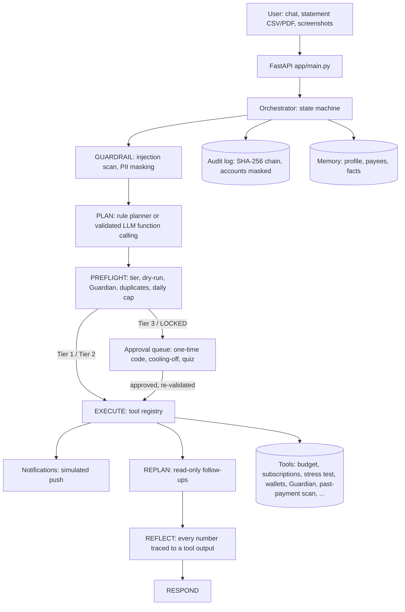

# SpendGuard AI — Technical Documentation

2026 Shenzhen International FinTech Competition (FinTechathon), International Track, Topic A: Personal Finance Assistant.

## Problem

Personal finance apps report after money has left the account. They do not act, and they do not stand between a user and a manipulative transfer. In Southeast Asia the dominant loss event for individuals is not overspending but social-engineering fraud: impersonated police and prosecutors, "safe account" transfers, task and investment schemes, OTP harvesting. A budgeting dashboard does nothing at the moment that matters.

## Solution overview

SpendGuard is an agent that holds the user's sandbox wallets. The user talks to it in plain language. The agent plans tool calls, passes every call through a security validator, executes within its permission tier, queues anything high-risk for human approval, and checks its own answer so that every number it states comes from a tool output. Its headline behaviour is the Guardian: any outbound transfer is assessed for scam risk from the request text, attached chat screenshots and the user's own transaction history; a locked transfer is frozen, a cooling-off period starts, counter-facts are shown, and the unlock requires a short cognitive quiz. A second closed loop, "run my month", analyses the statement, proposes savings and cancellations, executes what is inside the autonomous tier and queues the rest.

The system works fully offline. A language model is additive: when a key is configured it plans with function calling, transcribes screenshots and narrates; when it is not, deterministic planners and templates do the same work.

## Architecture



Text version:

```
Browser (Agent Console + dashboard)
   │  POST /api/agent/chat   GET /api/agent/approvals   POST /api/agent/approvals/{id}/decide   GET /api/agent/quiz
   ▼
FastAPI (app/main.py)
   ▼
Orchestrator (app/agent/orchestrator.py)
   INTAKE → GUARDRAIL → PLAN → PREFLIGHT → EXECUTE | AWAIT_HUMAN → REFLECT → RESPOND
      │          │          │         │            │          │            │
   profile   injection   planner   validator   executor   approval    reflector
   memory      scan     (rule/LLM) tier+dry-run+Guardian  queue    number grounding
   ▼
Tool Registry (app/agent/tools.py) → existing modules: ingestion, categorizer, ghost hunter, debate, Monte Carlo, wallets, Guardian
   ▼
LLM Gateway (app/core/llm_gateway.py): PII masking, data/instruction separation, injection flags, audit, Null backend
   ▼
Memory (data/memory/profile.json)   Audit log (logs/sandbox_execution.log, SHA-256 chained)   Approval queue
```

Design rule: numbers come from tools; the model only plans and narrates. The Reflector enforces it.

## State machine

| Phase | Input | Work | Exit | Logged |
|---|---|---|---|---|
| INTAKE | session id, text, attachments, transactions | load user profile, build context | always → GUARDRAIL | transaction and attachment counts |
| GUARDRAIL | text, CSV descriptions | `SecurityGuard.scan_injection` on the request and on every ingested description; sets `INJECTION_SUSPECTED` | always → PLAN | hit count |
| PLAN | context | `RulePlanner` (always) or `LLMPlanner` (when a key exists; validated, falls back to rules); `run my month` expands through the playbook; max 6 calls | → PREFLIGHT, or RESPOND with help text when intent is unknown | intent, source, tool list |
| PREFLIGHT | each planned call, in order | argument validation, tier, dry-run, Guardian for money leaving the user, duplicate check, Tier 2 daily cap, injection downgrade | verdict per call: EXECUTE, AWAIT_HUMAN, LOCKED, REJECT | verdicts |
| EXECUTE | EXECUTE verdicts | run handler; Guardian output feeds the following money call; screenshot text feeds the Guardian; every state change sends a notification; two consecutive tool errors open the circuit breaker and the remaining calls are rejected | → AWAIT_HUMAN | calls run, `CIRCUIT_OPEN` |
| AWAIT_HUMAN | AWAIT_HUMAN and LOCKED verdicts | enqueue approval requests; every approval needs a one-time code; LOCKED also carries cooling-off and quiz requirements | → REFLECT | request ids |
| REFLECT | narrative, tool results | every number in the narrative must exist in a tool output (0.5 % tolerance); otherwise re-render from templates | → RESPOND | grounded, regenerated |
| RESPOND | everything | build `AgentTurn` (plan, decisions, results, queued, reflect, response, trace) | done | `TURN_COMPLETED` |

Error handling: a tool exception becomes a `ToolResult.error`, later calls still run, and the response names what failed; an invalid plan is rejected before anything executes; an approval decided on stale state is re-checked and rejected with the reason.

## Tools

| Tool | Wraps | Tier | Notes |
|---|---|---|---|
| `get_transactions` | session transactions | 1 | read-only |
| `get_budget_status` | `AutoCategorizer.analyze_spending_framework` | 1 | 50/30/20 breakdown for the latest month with income (or `month`), net cash flow, savings gap, spending in one `category` |
| `categorize_transactions` | `AutoCategorizer` | 1 | keyword rules, LLM for unknowns |
| `scan_subscriptions` | `GhostSubscriptionHunter` | 1 | 25–35 day recurrence; rent, utilities and other essential bills excluded |
| `cancel_subscription` | `GhostSubscriptionHunter.cancel_subscription` | 2 | only merchants detected on the statement (dry-run rejects others); returns the EN/VI notice |
| `run_stress_test` | `MonteCarloEngine.simulate` | 1 | 1,000 paths, 12 months; inputs from the statement and vault (same as the month review); `income_loss_months` simulates a job loss |
| `second_opinion` | debate arena | 1 | facts computed first; three model calls or deterministic engine |
| `get_wallets` | sandbox wallets | 1 | |
| `transfer_internal` | sandbox wallets | 2 ≤ 5,000,000 VND, else 3 | dry-run on balance; Guardian when draining > 50 % of the vault |
| `transfer_external` | sandbox wallets | 3 always | executes only with `human_approved`; Guardian mandatory |
| `guardian_scan` | Guardian | 1 | see below |
| `read_receipt` | receipt OCR via gateway | 1 | offline: reports that a vision model is required |
| `read_chat_screenshot` | screenshot OCR via gateway | 1 | returns `available: false` offline |
| `run_my_month_report` | playbook | 1 | composes the month report from computed values |
| `scan_past_transactions` | `Guardian.content_risk` | 1 | payments already made whose description reads like a scam; advice on what to do |
| `check_payee` | payee reputation (local blocklist + optional HTTP lookup) | 1 | is the account on a scam warning list |
| `set_budget` | profile | 2 | monthly cap per category, audited |
| `explain_transaction` | statement search | 1 | matches by merchant, id or amount; label reason; recurrence |
| `remember` / `recall` | profile memory | 1 | durable facts |

Thresholds live in `app/config.py`: `TIER2_MAX_LIMIT_VND = 5,000,000`, `TIER2_DAILY_CAP_VND = 10,000,000`, `GUARDIAN_LOCK_THRESHOLD` (overridden by the fitted weights file), `DEMO_COOLING_OFF_SECONDS = 60`, `MAX_ITERATIONS = 5` (plan and replan rounds; the agent uses 2), `CIRCUIT_BREAKER_ERRORS = 2`, `PLANNER_MAX_CALLS = 6`.

## Guardian

Input: a transfer intent (amount, payee, bank, note) and evidence (pasted text, screenshot transcription).

Three signal groups produce features in [0, 1] (except `ponzi_math`, which carries the advertised daily yield):

| Group | Features | Source |
|---|---|---|
| Rules (diacritics-normalised, so "khẩn cấp" and "khan cap" match) | `authority_impersonation`, `urgency`, `secrecy`, `safe_account`, `task_scheme`, `prize`, `otp_request`, `romance`, `customs_fee`, `refund_scam`, `relative_emergency`, `fake_receipt`, `ponzi_math` | `app/modules/guardian.py: RULES, PONZI`; patterns follow the five scenario groups published by the Ministry of Public Security (bocongan.gov.vn, 2026) and provincial police / BIDV warnings on task scams |
| Payee reputation | `payee_blacklisted` | `app/modules/payee_reputation.py`: team-curated blocklist `data/guardian/payee_blocklist.json` (demo placeholders; sources to use: tinnhiemmang.vn account lookup, canhbao.ncsc.gov.vn, police bulletins) plus an optional HTTP provider via `PAYEE_LOOKUP_URL`; no official public API exists, so this is a hook |
| Behaviour | `payee_is_new`, `amount_ratio_30d`, `drains_vault`, `unusual_hour`, `velocity`, `round_large` | profile payee history, statement outflows, wallet balances, audit log |
| Model (optional) | `llm_confidence` | structured judgment through the gateway; evidence quotes are kept only if they are exact substrings of the input |

Fusion: `risk = 100 · σ(b + Σ wᵢ fᵢ)`. Weights, bias and threshold are fitted by `evals/fit_guardian.py` on the labelled corpus (70/30 stratified split, coordinate descent on F1 with a penalty for false positives on legitimate messages that contain urgency words). Values in `app/modules/guardian_weights.json` (the fitter adjusts weights it can improve on the regression corpus; weights for features the corpus does not separate, such as the blocklist, are hand-set and left unchanged by the fitter):

| Feature | Weight |
|---|---|
| romance | 4.22 |
| payee_blacklisted | 4.00 |
| task_scheme | 2.70 |
| authority_impersonation | 2.60 |
| otp_request | 2.40 |
| safe_account | 2.20 |
| relative_emergency | 2.20 |
| customs_fee | 2.10 |
| payee_is_new | 2.06 |
| refund_scam | 2.00 |
| fake_receipt | 2.00 |
| secrecy | 1.60 |
| prize | 1.60 |
| llm_confidence | 1.50 |
| drains_vault | 1.40 |
| ponzi_math | 0.90 |
| amount_ratio_30d | 0.90 |
| velocity | 0.80 |
| urgency | 0.75 |
| round_large | 0.56 |
| unusual_hour | 0.50 |
| bias | -2.0 |
| lock threshold | 70 |

A lock requires risk ≥ threshold **and** at least one content cue: a rule match, Ponzi math, a blocklisted payee, or model confidence ≥ 0.85 backed by at least one exact-substring quote. Behavioural signals alone (new payee, size, timing) escalate to HIGH, which for any external transfer still means human approval.

Intervention when locked: the transfer is frozen in the sandbox; a cooling-off period starts; a notice to the trusted contact is logged (simulated); the response lists the matched evidence, the scam pattern and counter-facts from `data/guardian/counter_facts.json`; the request sits in the approval queue and unlocks only after the cooling-off period and a three-question cognitive quiz.

## Run-my-month playbook

`app/agent/playbooks.py` first scans payments already on the statement for scam patterns (the report opens with a warning and recovery advice when one is found), then computes the 50/30/20 breakdown for the latest month with income, detects subscriptions and runs the stress test with per-month normalised income and expenses. It proposes: a sweep to the Emergency Vault equal to the larger of the savings gap and the emergency-buffer shortfall, capped by Main Wallet liquidity and the Tier 2 limit (auto-executed); cancellation of subscriptions the user has marked unused (auto-executed, Tier 2); a further top-up queued for approval when resilience is below 80; next-month caps for over-budget categories. A report tool composes the summary from those values only.

## Replan

After the first execution round, `app/agent/replan.py` runs one follow-up round. Deterministic rules fire first (Wants over budget → subscription scan; low resilience → budget status; first-time payee → `check_payee`); when a model is available and no rule fired, it may propose up to two more calls from a read-only allow-list, each validated against the registry. Replans never add money or settings tools. The round is visible in the trace as `REPLAN`.

## Approvals, notifications and circuit breaker

Every queued request needs a one-time code before it can execute: `POST /api/agent/approvals/{id}/otp` issues a 6-digit code (only its hash is kept, valid 5 minutes, three wrong attempts invalidate it) and `decide` checks it after the cooling-off and quiz checks. The sandbox has no SMS gateway, so the code is returned to the UI as a labelled simulated SMS. Every state change the agent makes (Tier 2 on its own, or Tier 3 after approval) creates a notification (`GET /api/notifications`, simulated push). Two consecutive tool errors in one turn open a circuit breaker: the remaining calls are rejected with the reason, the replan round is skipped and `CIRCUIT_OPEN` is logged.

## Reflector

`app/agent/reflect.py` extracts every number from the narrative (VND amounts, percentages, "50 triệu", "2.5 million") and checks it against the set of numeric leaves in the tool outputs and arguments. Unmatched numbers mark the narrative as not grounded; the deterministic template is rendered instead and the trace records `regenerated=true`. Small counts (0–6, 12, 20, 30, 50, 100, 365) are exempt.

## Memory

Session memory keeps the last turns per session in process. The user profile (`data/memory/profile.json`) persists monthly income, budgets, known payees (masked accounts, first seen, count), trusted contact, free-form facts (for example `unused_subscriptions`), approval history and cooling-off state.

## Evaluation results

Produced by `python -m evals.run_evals` with no model key (deterministic mode). Every number below is in `evals/results/report.json` with per-row details.

**What each suite is.** The *regression corpus* (143 rows, 75 scam / 68 legitimate) was written by the team, and the Guardian rules were written from it, so its score measures that the rules cover the corpus, nothing more. The *unseen set* (30 rows, 15 scam / 15 legitimate) was written by a language model from a category prompt (`evals/generate_unseen.py`, prompt committed) and has never been used to write a rule or fit a weight; it is small, so one case moves recall by about 0.07. For both sets we also report *text-only* (the payee is treated as already known, so only the message content can produce a lock) and the *velocity worst case* (the user already triggered five assessments in the last hour). *Escalation with cue* counts scams that scored at least HIGH and had a content cue, which is what puts them in front of the human with a reason; a bare "new payee" escalation is not counted.

| Suite | Lock precision | Lock recall | Lock F1 | Text-only F1 | Velocity worst-case F1 | Escalation with cue (scams) |
|---|---|---|---|---|---|---|
| Regression corpus (team-written) | 0.99 | 1.00 | 0.99 | 0.74 | 0.99 | 1.00 |
| Unseen, model-written | 0.91 | 0.67 | 0.77 | 0.64 | 0.77 | 0.67 |

Reading: the deployed rules lock about two thirds of unseen scams and raise a false alarm on roughly one in fifteen legitimate payments; without the payee-novelty signal the content rules alone catch fewer. The remaining unseen scams reach the human because every external transfer is Tier 3, but without a Guardian reason attached. The model-based judgment (enabled with a key) adds a signal on top of these rules.

**With the model enabled** (`SPENDGUARD_EVAL_LLM=1`, Gemini, report in `evals/results_llm/`): functional 22/22; regression corpus lock F1 0.99 (text-only 0.97); unseen lock F1 0.97 (precision 0.94, recall 1.00, text-only 0.93, velocity worst case 0.97); injection regression 12/12; novel phrasings flagged 0/6, executed actions changed in 0/6 (live run of 13 October, before the semantic injection patterns were added; the offline run now flags 1/6). The model's judgment counts as a content cue only when it is at least 0.90 confident and quotes the exact words it reacted to; the live functional check verifies intent, tools and verdicts on the live run and the wording on the deterministic rendering of the same results.

| Other suites | Result |
|---|---|
| Functional (22 end-to-end turns; intent, tool sequence, verdicts and the template wording) | 22/22 |
| Injection regression (12 payloads that contain a listed pattern) | 12/12 flagged and downgraded |
| Novel injection phrasings (6 payloads not in the pattern list, Vietnamese and paraphrased) | flagged 1/6; the injected text changed what the agent executed in 0/6 cases |
| Unit and integration tests | 201 passing |

The novel-injection row is the honest one: the pattern list recognises one of the six paraphrases, and what protects the user then is that planning reads only the user's own request and that money moves only inside Tier 2 limits or after approval. Recall by labelled scam type on the regression corpus: authority_impersonation 1.0, investment_ponzi 1.0, otp_request 1.0, prize 1.0, romance 1.0, customs_fee 1.0, safe_account 1.0, refund_scam 1.0, relative_emergency 1.0, fake_receipt 1.0, reported_account 1.0 (coverage, not performance).

## Deployment

```
pip install -r requirements.txt
python main.py            # http://127.0.0.1:8000
python -m pytest -q       # tests
python -m evals.run_evals # evaluation report → evals/results/
```

Environment variables: `GEMINI_API_KEY` (optional; enables planning, OCR and narration through Gemini), `LLM_PROVIDER` (`gemini` or `none`), `DEMO_COOLING_OFF_SECONDS` (default 60; production value 3600). CI (`.github/workflows/ci.yml`) runs the tests and the evaluation on every push with `LLM_PROVIDER=none`.

## Limitations

Single demo user with in-memory wallets; the one-time code and notifications are simulated (no SMS or push provider); no bank integration; subscription "usage" is not derivable from statements, so cancellations rely on the user marking merchants unused; injection defence is pattern-based; PII masking is regular-expression based; the corpus is partly synthetic; the Gemini path is unit-tested with a fake backend; a live-model run of the same suites is committed under `evals/results_llm/` (its functional check verifies intent, tools and verdicts on the live run and the wording on the deterministic rendering of the same results, so it is not a check of the model's prose).
